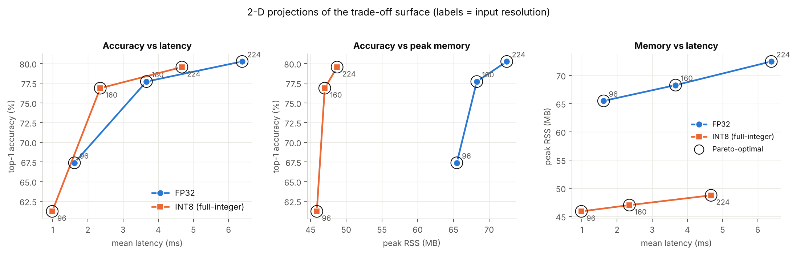

# MobileNetV2 edge deployment: full-integer INT8 TFLite on a 256 MB / 1-core device

Lab 8 (Edge Deployment). A pre-trained **MobileNetV2** is converted to **TensorFlow Lite with full-integer (INT8)
quantisation**. The resulting **FlatBuffer** is inspected to see which operators were quantised and which fell back
to float. The model is then deployed on a **simulated edge device** (kernel-enforced 256 MB RAM limit, one CPU core,
single-threaded LiteRT) and measured at **224×224, 160×160 and 96×96** input size. The notebook ends with the
latency–accuracy–memory trade-off surface and a written report.

📄 **[Lab8_Edge_Deployment.pdf](Lab8_Edge_Deployment.pdf)**: the full executed notebook with code, outputs,
figures and the written report.
📓 **[Lab8_Edge_Deployment.ipynb](Lab8_Edge_Deployment.ipynb)**: the same notebook, runnable.



## Results on the simulated device (1 core, 256 MB)

Accuracy is strict 1000-way ImageNet top-1/top-5 on all 3,925 Imagenette validation images. It was measured on
the device, by the same `.tflite` files that were timed.

| input | precision | file | top-1 | top-5 | mean latency | p95 | peak RSS | model memory |
|---|---|---|---|---|---|---|---|---|
| 224×224 | FP32 | 14.0 MB | 80.25% | 97.38% | 6.39 ms | 8.88 ms | 72.5 MB | 38.6 MB |
| 224×224 | **INT8** | 4.04 MB | 79.54% | 96.94% | 4.67 ms | 5.82 ms | 48.7 MB | 14.8 MB |
| 160×160 | FP32 | 14.0 MB | 77.71% | 96.38% | 3.67 ms | 5.00 ms | 68.3 MB | 34.4 MB |
| 160×160 | **INT8** | 4.04 MB | 76.87% | 96.08% | 2.35 ms | 2.52 ms | 47.0 MB | 13.1 MB |
| 96×96 | FP32 | 14.0 MB | 67.39% | 89.91% | 1.62 ms | 2.27 ms | 65.5 MB | 31.6 MB |
| 96×96 | **INT8** | 4.04 MB | 61.22% | 86.17% | 0.99 ms | 1.11 ms | 45.9 MB | 12.0 MB |

## Key findings

- **Every MobileNetV2 operator got an INT8 kernel.** The integer-only FlatBuffer has 67 compute ops, all INT8, and
  2 uint8↔int8 requantisations at the I/O. Weights are int8 with per-channel scales and biases are int32. The file
  shrinks 3.5×.
- **INT8 is 1.37–1.64× faster** and needs **~2.6× less model memory**. It costs 0.71 pp of top-1 at 224 px and
  0.84 pp at 160 px, but 6.17 pp at 96 px, where predictions have smaller margins and noise is averaged over a
  3×3 instead of a 7×7 final feature map.
- **Float fallback is silent.** 10 of 23 probed ops (`square`, `pow`, `sin`, `cos`, `floor`, `round`, `sign`,
  `elu`, `cumsum`, `atan2`) have no INT8 kernel. The converter wrapped them in `DEQUANTIZE → op → QUANTIZE`
  **without an error, even with `TFLITE_BUILTINS_INT8`**.
- **One float op is costly.** A single `POW` (gamma correction for a linear-light camera) added **+2.27 ms (+48%)**
  per image. It also cut the share of MACs a single-partition integer accelerator such as the Edge TPU could run
  from 100% to 0%. Rewriting it as `exp(log(x)/γ)` with INT8-capable ops restored an all-integer graph
  (+0.07 ms, 79.69% top-1).
- **A silent converter failure.** Scaling an image down to [0, 1] and back up to [0, 255] made the converter give
  the [0, 1] tensor the scale of the [0, 255] tensor. The image ended up with 2 grey levels and top-1 fell to 14%,
  with no warning (notebook Section 11.1).
- **Recommended deployment: INT8 at 160×160.** It reaches 76.9% top-1 at 2.35 ms and 47 MB, 2.7× faster than
  FP32-224 for 3.4 pp of accuracy.

## How the edge device is simulated

Every on-device run is a fresh process started inside new Linux **cgroups**, the same mechanism as
`docker run --memory=256m --cpus=1`:

- **memory:** `memory.limit_in_bytes = 256 MiB`, with no swap. A 300 MB allocation is OOM-killed (verified in the
  notebook).
- **CPU:** a CFS quota of 1 core, plus cpuset/`taskset` pinning to core 0.
- **runtime:** `Interpreter(num_threads=1)`.
- **software:** only NumPy and the stand-alone LiteRT runtime (`ai_edge_litert`, 33 MB RSS) run on the device.
  Full TensorFlow (520 MB) is never loaded there.

## Repository layout

| path | contents |
|---|---|
| `Lab8_Edge_Deployment.ipynb` | the lab, executed |
| `Lab8_Edge_Deployment.pdf` | PDF export of the notebook |
| `edge_device_worker.py` | program that runs inside the simulated device (written by the notebook) |
| `figures/` | input resolutions, per-layer quantisation error, latency distributions, 3-D surface, 2-D projections |
| `results/` | every measured table as CSV/JSON (benchmarks, accuracy, FlatBuffer op tables, op probe, case study) |

## Re-running

```bash
pip install tensorflow-cpu ai-edge-litert matplotlib pandas pillow jupyter
jupyter nbconvert --to notebook --execute --inplace Lab8_Edge_Deployment.ipynb
```

The first run downloads Imagenette (~340 MB) and the Keras weights. Creating cgroups needs root on Linux (cgroup v1,
or a delegated v2 hierarchy). Without it, the sandbox only pins the CPU and labels the memory limit
*not enforced*.

**Environment used:** Python 3.13, TensorFlow 2.21 (converter), LiteRT 2.3 (runtime), on an Intel Xeon host.
Absolute latencies are therefore much lower than on an ARM board, and the sandbox reproduces the device's memory
capacity and core count, not its clock speed. Imagenette is an ImageNet subset, so absolute accuracy is higher than
the ≈72% ImageNet-val figure. The FP32-vs-INT8 and resolution comparisons are unaffected.
